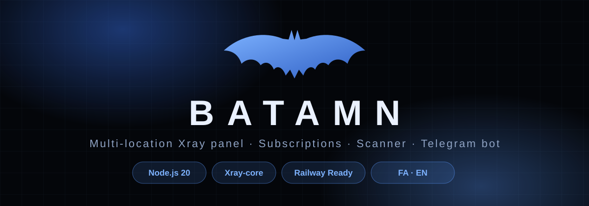
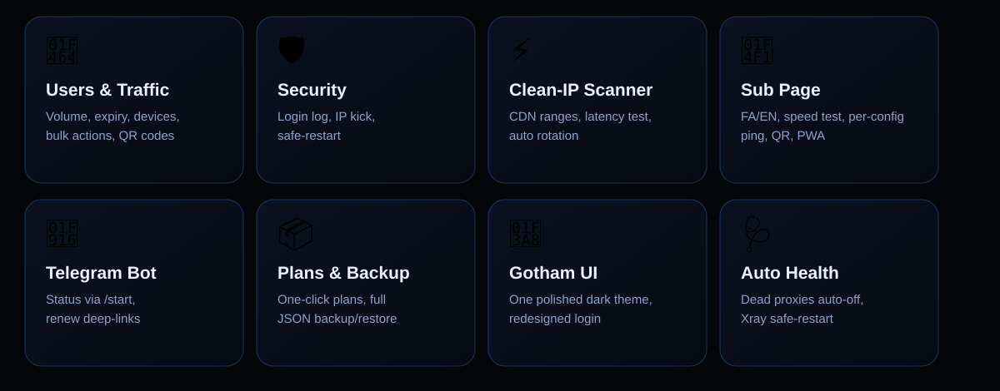
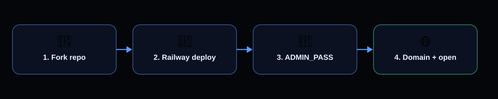
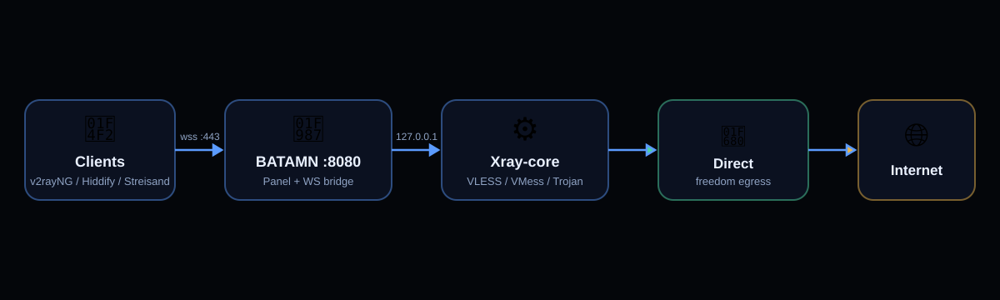

<div align="center">
  

  <p>
    <b>Multi-location Xray control panel — users, subscriptions, clean-IP scanner, SOCKS egress locations and Telegram automation.</b><br />
    Single-port Node.js app, built for Railway. Persian + English UI.
  </p>

  <p>
    
    
    
    
    
  </p>
</div>

---

<details>
<summary><b>📚 Table of contents</b></summary>

- [Why BATAMN?](#-why-batamn)
- [Deployment](#-deployment)
- [Environment variables](#️-environment-variables)
- [Panel tour](#-panel-tour)
- [Subscription page](#-subscription-page)
- [Multi-location (SOCKS egress)](#-multi-location-socks-egress)
- [API reference](#-api-reference)
- [Project structure](#-project-structure)
- [In-panel GitHub updater](#-in-panel-github-updater)
- [Security notes](#-security-notes)
- [FAQ](#-faq)
- [Credits](#-credits)
- [مستندات فارسی](#-مستندات-فارسی)

</details>

## ✦ Why BATAMN?

Everything a small VPN service needs in one lightweight panel: users with traffic/expiry/device limits, generated VLESS/VMess/Trojan links, QR codes, a clean-IP scanner, multi-location egress through SOCKS5/HTTP proxies, and a minimal Telegram bot — all behind a single HTTP port.

<div align="center">
  
</div>

| Area | What you get |
|---|---|
| 👤 Users | Create/manage accounts, volume + expiry + device limits, bulk actions, sorting, per-user QR |
| 🌍 Locations | SOCKS5/HTTP egress per inbound, proxy sources, auto protocol detect, auto country flags, health monitor |
| ⚡ Scanner | Clean-IP scan over CDN ranges, fastest-first results, auto rotation |
| 📱 Sub page | FA/EN, usage ring + forecast, 14-day chart, speed test, per-config ping, QR, PWA |
| 🤖 Telegram | `/start + id` status lookup, renew deep-links, support/channel buttons |
| 📦 Plans & backup | One-click plans, full JSON backup/restore |
| 🎨 Themes | Knight, Gotham, Joker, Light + redesigned login |
| 🩺 Reliability | Xray config test before restart, crash-loop guard, error display + manual restart |

---

## 🚀 Deployment

<div align="center">
  
</div>

### Option A — Railway (recommended)

1. Fork/push this repo to your GitHub account.
2. Create a new Railway project from the repo (uses `Dockerfile`).
3. Set the `ADMIN_PASS` variable (your panel password).
4. Add a persistent volume mounted at `/data` (keeps `db.json` + Xray logs).
5. Generate a public domain and open it — log in with your password.

### Option B — VPS / manual

```bash
# 1. install xray binary into PATH (https://github.com/XTLS/Xray-core/releases)
# 2. install deps
npm i qrcode-generator@1.4.4 --no-audit --no-fund
# optional fonts:
npm i vazirmatn @fontsource-variable/inter @fontsource-variable/jetbrains-mono

# 3. run (data dir + admin password via env)
ADMIN_PASS=change-me BATAMN_DATA=./data node boot.js
```

The panel listens on `PORT` (default `8080`). Behind Railway/Cloudflare, public TLS on `443` is terminated by the platform and WebSocket traffic is bridged to Xray internally — no extra ports needed.

---

## ⚙️ Environment variables

| Variable | Default | Purpose |
|---|---|---|
| `PORT` | `8080` | Panel HTTP port |
| `BATAMN_DATA` / `DATA_DIR` | `/data` (falls back to `./data`) | Database + logs + Xray config |
| `ADMIN_PASS` | `admin` | Initial panel password (change it!) |
| `PUBLIC_HOST` | — | Force public hostname for links (overrides auto-detect) |
| `GITHUB_REPO` | — | `owner/repo` for the in-panel updater (or set it in Settings) |
| `GITHUB_API` | `https://api.github.com` | GitHub API base (for mirrors) |

---

## 🖥 Panel tour

- **داشبورد / Dashboard** — users, online devices, traffic, connections, 14-day chart, server gauges (CPU/RAM/disk), network sparkline, expiring-soon list, top users, speed test, per-IP kick (✕ bans an IP for 30 min).
- **کاربران / Users** — search, status filters, sorting (newest / top usage / name / expiry), bulk select: extend +reset traffic +delete, per-user subscription link + QR + page.
- **اینباندها / Inbounds** — VLESS/VMess/Trojan over WS/HTTPUpgrade on the same port 443, separate paths; each inbound has an editable **location label** (e.g. `🇩🇪 آلمان`) used in config names.
- **اسکنر / Scanner** — tests random CDN IPs from `assets/cf_subnets.txt` for the fastest clean IPs; one click sets the default address.
- **لوکیشن‌ها / Locations** — SOCKS5/HTTP proxies as egress locations: fetch from sources, auto protocol detect, real-tunnel test with failure reasons, **auto country flag + egress IP**, per-inbound egress assignment, one-click inbound creation (＋), auto health monitor that disables dead proxies.
- **تنظیمات / Settings** — main + fallback domains, default address, panel password, contact IDs, plans, payment info, Telegram bot, auto clean-IP rotation, security log (recent logins), backup/restore, themes, GitHub updater.

---

## 📱 Subscription page

Every user gets a personal page at `/sub/<id>` (and a base64 subscription link for clients):

- Usage ring + remaining/total/expiry tiles, daily average, **depletion forecast**, 14-day usage chart
- Live device dots, auto-refreshing online status, expired/limited states with renew CTA
- Copy subscription link, subscription QR (downloadable), per-config copy + QR, protocol filter + search
- **Per-config latency test** over WebSocket with fastest-first sorting
- Built-in **speed test** (ping/jitter/download/upload against your own server)
- Platform guides (Android/iOS/Windows), support + channel buttons, payment card display
- **FA/EN toggle**, fallback-domain switch, PWA manifest (add to home screen)

---

## 🌍 Multi-location (SOCKS egress)

<div align="center">
  
</div>

How it works (same model as SpiderPanel):

1. **Locations tab → دریافت و تست ⚡** — proxies are pulled from configurable sources, SOCKS5/HTTP is auto-detected in parallel (fastest wins), each candidate is verified with a **real tunnelled request** (not just TCP).
2. The **true egress IP** is read from inside the tunnel and geolocated (ipwho → ipinfo → ip-api fallbacks — never the panel server's country). The location is auto-labelled `🇩🇪 Germany` with its egress IP.
3. Press **＋** on a location to auto-create a wired inbound (`Proxy · 🇩🇪 Germany`, unique path), or assign any inbound's egress manually. Config remarks carry the country automatically.
4. The **health monitor** re-tests enabled locations periodically and auto-disables dead ones so configs don't go dark.

> Entry is always your own domain (that's where Xray listens); SOCKS changes the **exit** IP/country that websites see. Free public proxies die fast — for production use a private SOCKS server.

---

## 🔌 API reference

Selected authenticated endpoints (`bt` cookie; all JSON):

| Endpoint | Purpose |
|---|---|
| `GET /api/state` | Full panel state (users, inbounds, settings, daily traffic) |
| `GET /api/sys` | CPU/mem/disk/net, online summary, Xray status + last error |
| `POST /api/users` · `/api/user/update` · `/api/user/del` | User CRUD (volume GB, days, devices, note, reset) |
| `POST /api/users/bulk` | Group extend / reset / delete |
| `POST /api/user/kick` | Block a user IP for 30 min |
| `POST /api/inbounds` · `/api/inbound/update` · `/api/inbound/del` | Inbound CRUD (incl. `loc`, `egress`) |
| `POST /api/scan` | Clean-IP scan |
| `GET /api/locs` · `POST /api/loc/add|update|del|test|fetch|inbound` | Location management |
| `POST /api/settings` | All settings (domains, plans, payment, bot, sources, theme, …) |
| `GET /api/backup` · `POST /api/restore` | Full DB backup/restore |
| `GET /api/security` · `GET /api/bot/test` · `POST /api/xray/restart` | Security log, bot check, Xray restart |

Public: `GET /sub/<id>` (HTML page or base64 subscription), `GET /sub/<id>/live`, `GET /sub/<id>/manifest`, `GET /qr?d=…`, `/speed/*`, `/health`.

---

## 📁 Project structure

```text
.
├── server.js        # panel API + Xray orchestration + SOCKS/location engine
├── app.js           # panel frontend (dashboard/users/inbounds/scanner/locations/settings)
├── index.html       # panel shell + redesigned login
├── sub.html         # subscription page (FA/EN, charts, speed test)
├── style.css        # themes (knight/gotham/joker/light) + all UI
├── boot.js          # supervisor: runs image copy or updater-installed copy
├── speed.js         # shared speed-test engine
├── assets/          # cf_subnets.txt (scanner ranges)
├── svg/             # README artwork (logo/hero/features/architecture/deploy)
├── Dockerfile       # node:20-slim + xray + fonts
└── railway.json     # Railway deploy config
```

---

## 🔄 In-panel GitHub updater

Set `owner/repo` (+ branch, optional token for private repos) in Settings → Update. The panel can **check** and **install** updates from GitHub without redeploying; `boot.js` runs the new copy and rolls back automatically if it crash-loops. A 30-minute auto-update toggle is included.

---

## 🔐 Security notes

- Change the default password immediately; it lives in `db.json` (`BATAMN_DATA`).
- Keep `ADMIN_PASS`, bot tokens and backups private — never commit `data/`.
- Use HTTPS for panel access (required for Secure cookies on custom domains).
- Free public SOCKS proxies are untrusted: content stays TLS-encrypted, but exit operators see destination metadata.
- Review subscription links before sharing publicly.

---

## ❓ FAQ

**Panel won't load on my custom domain.** The domain must point to the service with working HTTPS (Railway domain or Cloudflare-proxied). The login cookie is `Secure` on HTTPS and plain on HTTP automatically — mixed setups break login. Set the **main domain** in Settings so links always use it.

**Location configs don't connect but direct ones do.** Check: 1) the inbound's egress is assigned (Locations tab), 2) re-test the proxy (free ones die in hours), 3) Dashboard → Server card for Xray errors, 4) XRAY pill is ONLINE.

**Fetched proxies all time out.** Normal for public lists (90%+ dead). Add another source or use a private SOCKS server with auth.

**Xray shows OFFLINE.** Open Dashboard → Server card: the exact error is displayed with a manual restart button. Bad configs are test-rejected before they can kill the running instance.

---

## 💬 Credits

- Telegram: [@mamadi1048](https://t.me/mamadi1048) · [@editmamad_e](https://t.me/editmamad_e)
- Built with [Xray-core](https://github.com/XTLS/Xray-core) · Location model inspired by [SpiderPanel](https://github.com/amirh00sain/SpiderPanel)

## 📄 License

MIT — do whatever you want, attribution appreciated.

---

<div dir="rtl">

# 🇮🇷 مستندات فارسی

<div align="center">
  
</div>

## ✦ BATAMN چیست؟

**BATAMN** یه پنل مدیریتی سبک برای Xrayـه: ساخت و مدیریت کاربر (حجم، انقضا، محدودیت دستگاه)، لینک و QR اشتراک، اسکنر کلین‌آی‌پی، **مولتی‌لوکیشن با خروجی SOCKS**، ربات تلگرام و بکاپ — همه با یه پورت (`8080`) و آماده Railway. رابط فارسی و انگلیسی داره و ۴ تم (Knight، Gotham، Joker، Light) + صفحه لاگین جدید.

## 🚀 نصب روی Railway

1. ریپو رو Fork/Push کن تو گیت‌هاب خودت.
2. تو Railway از روی ریپو پروژه بساز (با `Dockerfile` بالا میاد).
3. متغیر `ADMIN_PASS` رو بذار (رمز پنل).
4. یه Volume روی `/data` اضافه کن تا دیتابیس نپره.
5. دامنه عمومی بساز و بازش کن — با رمزت وارد شو.

## 🌍 مولتی‌لوکیشن چطور کار می‌کنه؟

1. تب **لوکیشن‌ها** → «دریافت و تست ⚡»: پروکسی‌ها از سورس‌ها گرفته می‌شن، پروتکل (SOCKS5/HTTP) خودکار تشخیص داده می‌شه و با یه درخواست واقعی از داخل تونل تست می‌شن (نه فقط TCP).
2. **IP واقعی خروجی** از داخل تونل خونده و کشورش پیدا می‌شه (سه سرویس پشتیبان؛ هیچ‌وقت کشور سرور خودت قاطی نمی‌شه). لیبل خودش میشه `🇩🇪 Germany` با IP خروجی.
3. با دکمه **＋** برای هر لوکیشن یه اینباند آماده (`Proxy · 🇩🇪 Germany`) ساخته می‌شه، یا خروجی هر اینباند رو دستی انتخاب کن. اسم کانفیگ‌ها خودکار کشور رو می‌گیرن.
4. **مانیتور سلامت** دوره‌ای لوکیشن‌ها رو چک می‌کنه و مرده‌ها رو خودش خاموش می‌کنه تا کانفیگ‌ها نخوابن.

> ورودی همیشه دامین خودته (Xray اونجا گوش می‌ده)؛ ساکس فقط **خروجی** (IP/کشوری که سایت‌ها می‌بینن) رو عوض می‌کنه. پروکسی رایگان زود می‌میره — برای کار جدی SOCKS اختصاصی بگیر.

## 🔧 اگه مشکلی بود

- **پنل با دامین بالا نمیاد:** دامین باید HTTPS سالم داشته باشه؛ دامین اصلی رو تو تنظیمات ست کن.
- **کانفیگ لوکیشن وصل نمیشه ولی مستقیم وصله:** خروجی اینباند رو چک کن، پروکسی رو دوباره تست کن، خطای کارت Server رو بخون.
- **Xray آفلاینه:** کارت Server داشبورد خطای دقیق رو نشون میده + دکمه ری‌استارت دستی داره.

## 🔗 لینک‌ها

- تلگرام: [@mamadi1048](https://t.me/mamadi1048) · [@editmamad_e](https://t.me/editmamad_e)
- موتور: [Xray-core](https://github.com/XTLS/Xray-core) · ایده لوکیشن از [SpiderPanel](https://github.com/amirh00sain/SpiderPanel)

</div>
